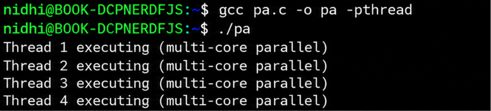
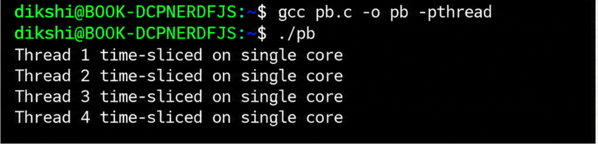

# Multithreading in C

## Aim
To implement multithreading using C programming.

## Experiments

### Part A: Multiprocessor Multithreading in C
This program demonstrates multithreading on a multiprocessor system using POSIX threads (`pthread`).

**File:** `experiment3_partA_multiprocessor.c`

**Output:** `experiment3_multiprocessor_output.png`

### Part B: Single Processor Multithreading in C
This program demonstrates multithreading on a single processor using POSIX threads and CPU affinity.

**File:** `experiment3_partB_single_processor.c`

**Output:** `experiment3_single_processor_output.png`

## Requirements
- C compiler (GCC)
- POSIX threads (`pthread`)
- Linux environment for Part B, which uses CPU affinity functions

## How to Compile and Run

### Part A: Multiprocessor Multithreading

Compile:

```bash
gcc experiment3_partA_multiprocessor.c -o partA -pthread
```

Run:

```bash
./partA
```

### Part B: Single Processor Multithreading

Compile:

```bash
gcc experiment3_partB_single_processor.c -o partB -pthread
```

Run:

```bash
./partB
```

## Output

The output images included in this repository are taken from the Operating Systems lab manual.

### Part A: Multiprocessor Output


### Part B: Single Processor Output


## Note
- Part B uses Linux-specific CPU affinity functions and may not compile directly on macOS.
- The output images show the outputs provided in the lab manual. Actual output may vary depending on the system and thread scheduling.

